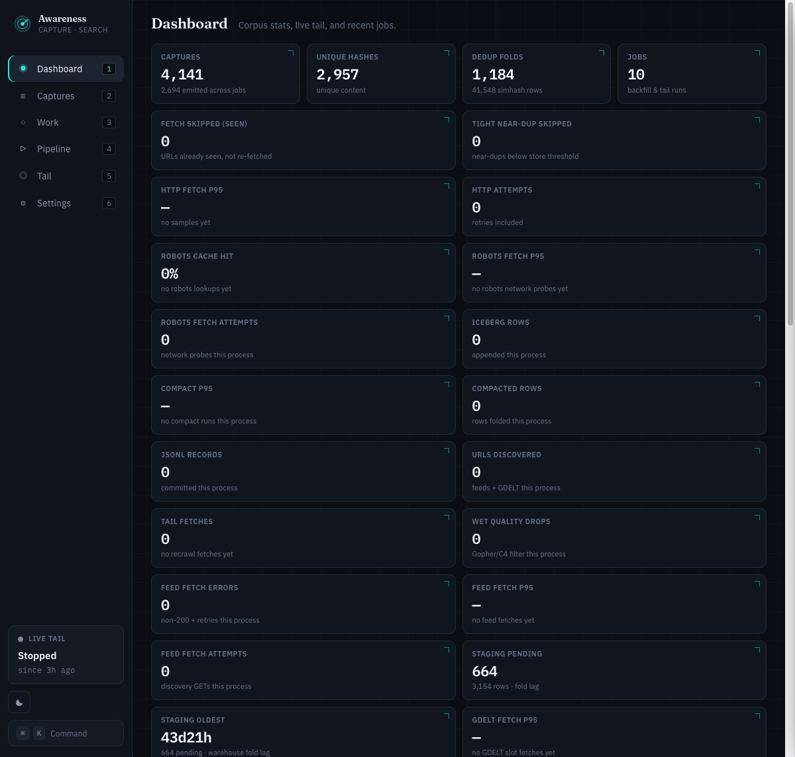
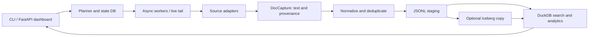
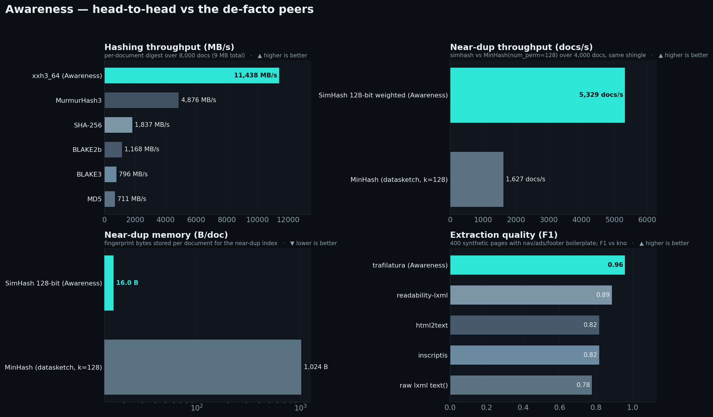
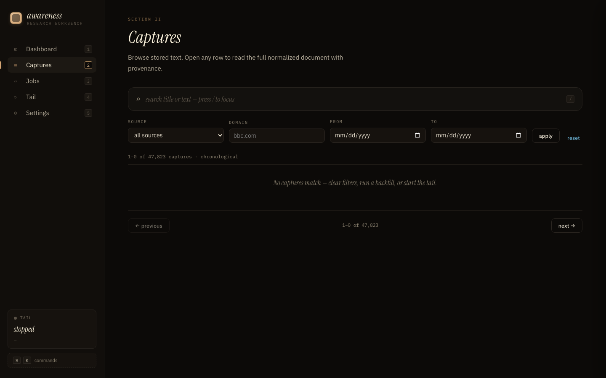
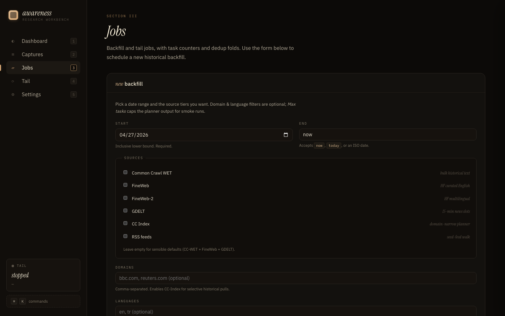
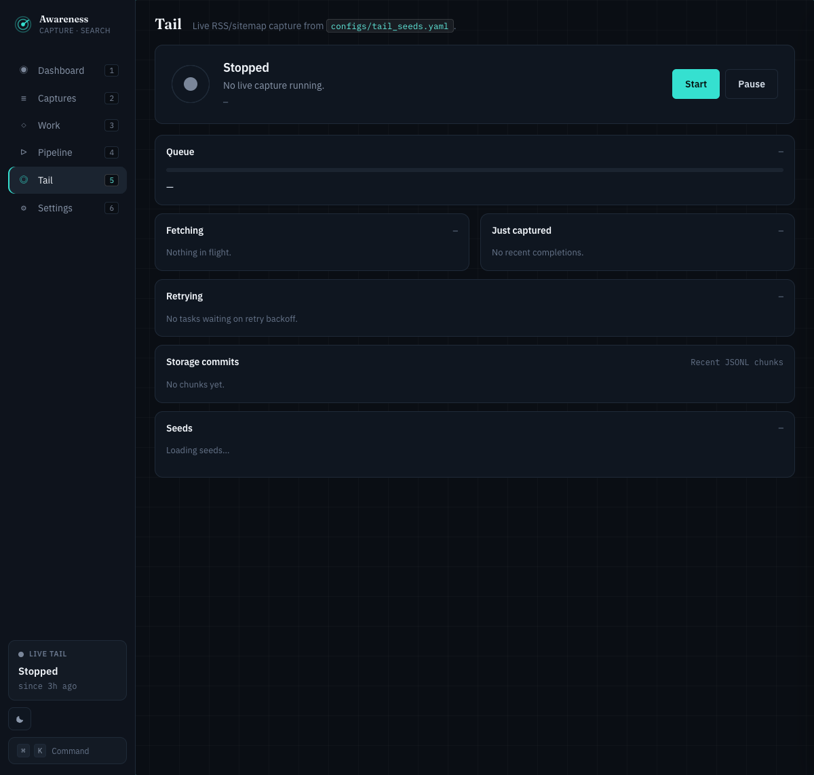
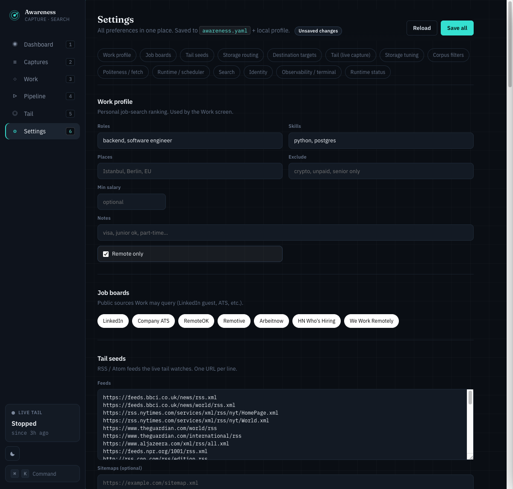

# Awareness

Awareness builds a searchable local collection of public web text. Backfill an archive, follow RSS feeds and sitemaps, then inspect the resulting corpus through a browser dashboard, a CLI or DuckDB queries.

[](https://github.com/nazmiefearmutcu/awareness/releases)
[](LICENSE)
[](https://python.org)
[](https://iceberg.apache.org/)
[](https://duckdb.org/)



## What it does

- **Historical backfill (BODY):** plans a date window into resumable jobs and tasks for Common Crawl, FineWeb/FineWeb-2, GDELT and feed-based sources.
- **Live capture (TAIL):** polls configured RSS/Atom feeds and sitemaps, extracts article text and records new captures with source and timestamp metadata.
- **Search and analysis:** full-text search, date/domain/language filters, term trends, topic lifecycle, corpus quality, heuristic entities, lexicon sentiment and source replication analysis.
- **Research workflows:** saved searches, alerts, briefings, digest/report export, public job-board search and X-session analysis with deterministic simulation and CSV export.

The FastAPI dashboard and Typer CLI share the same storage and processing modules. SMTP delivery, webhooks, GDELT comparison and Hugging Face publishing are explicit outbound integrations; local storage does not imply that every operation is offline.

## Markets layer (showme data backbone)

`awareness.markets` serves showme's news, sentiment, economic/corporate calendars, holidays, trading
sessions, SEC filings and market-sentiment indicators — sourced, quality-gated and keyless. Run
`python -m awareness.markets.app` (http://127.0.0.1:8086). Details: [docs/markets.md](docs/markets.md).

## Quick start

Requires **Python 3.11+**. From a terminal:

```bash
git clone https://github.com/nazmiefearmutcu/awareness.git
cd awareness
python -m venv .venv
```

Activate the environment with `source .venv/bin/activate` on macOS/Linux or `.venv\Scripts\Activate.ps1` in PowerShell. Then:

```bash
python -m pip install -e '.[dev]'
awareness init
awareness-api
```

Open `http://127.0.0.1:8085`. Configure sources and start the live tail from the dashboard, or run `awareness tail start` in another terminal. FineWeb adapters require the optional Hugging Face dependencies: `python -m pip install -e '.[dev,hf]'`.

## Common commands

```bash
awareness search "central bank" --limit 20
awareness browse
awareness backfill submit --start 2024-06-01 --end 2024-06-14 --max-tasks 5
awareness backfill run JOB_ID
awareness backfill status JOB_ID
awareness trends "bitcoin" --days 30 --chart
awareness quality --json
awareness export --out corpus.jsonl
awareness compact
```

Replace `JOB_ID` with the identifier returned by submission. `awareness commands` lists the command groups; use `--help` for individual options. [Operations recipes](docs/operations.md) cover scheduled briefings, alerts, quality snapshots and retention.

## Architecture



| Layer | Location and responsibility |
| --- | --- |
| Sources | `src/awareness/sources/`: adapters emit a shared [`DocCapture`](src/awareness/schemas/doc.py) record. |
| Scheduling | `planner/`, `workers/`, `tail/`: partition planning, async execution, retries, checkpoints and feed polling. |
| Text processing | `normalize/`, `dedup/`: extraction, content/URL identity and 128-bit SimHash grouping. |
| Persistence | `storage/`: JSONL batches, Iceberg tables, SQLite state and a DuckDB query index. |
| Access | `api/`, `cli/`: dashboard, HTTP endpoints, terminal commands and research modules. |

JSONL batches use temporary files, sync and rename; recovery handles orphaned temporary files. Iceberg is a configurable second copy. Deduplication skips durable full-text writes for exact duplicates, revisions and tightly matched near-duplicates; other captures retain their grouping and provenance metadata. See [architecture](docs/architecture.md) and the [data dictionary](docs/data_dictionary.md) for details.

## Configuration and boundaries

Defaults load from `configs/awareness.yaml`; `AW_*` environment variables override YAML values. Data normally lives under `data/`, including JSONL captures, the Iceberg warehouse and SQLite state.

| Variable | Purpose |
| --- | --- |
| `AW_DATA_DIR` / `AW_CONFIG_FILE` | Select the data directory or configuration file. |
| `AW_API_HOST` / `AW_API_PORT` | Bind address and port; defaults are loopback and `8085`. |
| `AW_API_KEY` | Require a bearer token for the control plane; required for a non-loopback binding. |
| `AW_ENABLE_ICEBERG` | Enable or disable the Iceberg copy. |
| `AW_PER_DOMAIN_CONCURRENCY` / `AW_TAIL_POLL_SECONDS` | Control live fetch concurrency and polling. |
| `AW_ALERTS_AUTOSTART` | Enable periodic alert evaluation inside the API process. |

Live fetching checks `robots.txt` and applies per-domain limits. Durable records contain text and metadata; HTML/WARC bytes may be cached during processing. Coverage depends on upstream archives and available public pages. The engine does not authenticate to websites or bypass paywalls. `--max-tasks` limits the initial backfill plan; source discovery can enqueue additional tasks.

Entity, sentiment and topic labels are heuristic research outputs. They need validation for a specific corpus or decision. Optional infrastructure in `ops/compose/` is documented in the [runbook](docs/runbook.md); availability of a service there does not establish that every integration is complete.

## Benchmarks



This preserved chart summarizes checked-in synthetic benchmark results, not performance guaranteed for a live corpus. The current [results JSON](docs/benchmarks/results.json) records Python 3.13.9 on arm64 macOS. [Reports and methodology](docs/benchmarks/README.md) describe datasets, peers and tradeoffs, including near-duplicate recall versus throughput.

To reproduce the benchmark suite in the active environment:

```bash
python -m pip install -e '.[bench]'
python -m benchmarks.run_all
python -m benchmarks.plot
```

## Screenshots

<details>
<summary>Capture search, pipeline, live tail and settings</summary>









</details>

## Development

```bash
pytest
pytest -m smoke
ruff check .
mypy src
python scripts/e2e_smoke.py
```

The smoke harness exercises ingestion, search, analytics, API and research workflows in a temporary project root. See [CONTRIBUTING.md](CONTRIBUTING.md) and [SECURITY.md](SECURITY.md).

## License

[MIT](LICENSE). Source access and content rights still depend on the sites and datasets you collect.

Created By Aylin (Nazmi Efe Armutcu)
